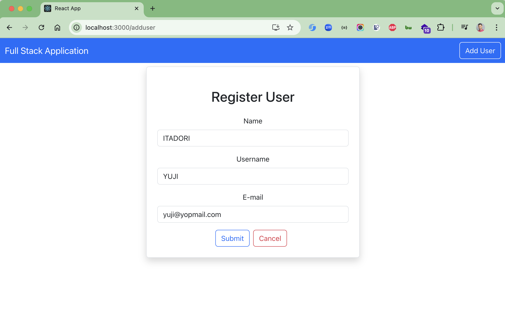
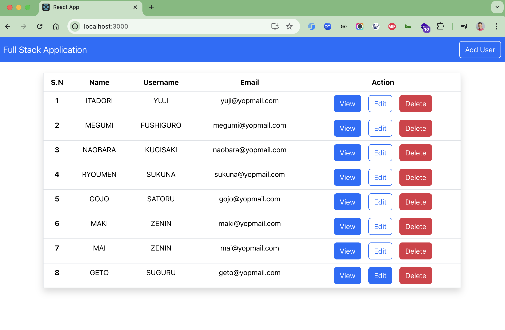
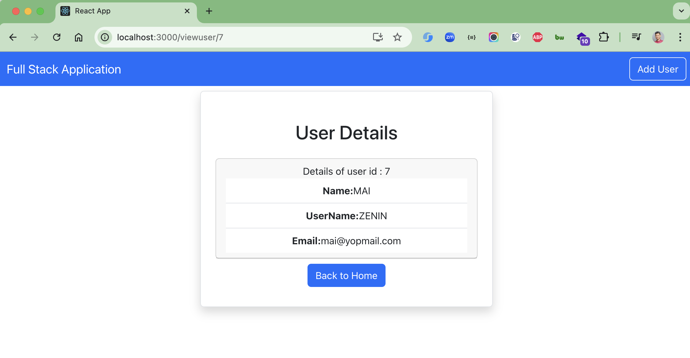
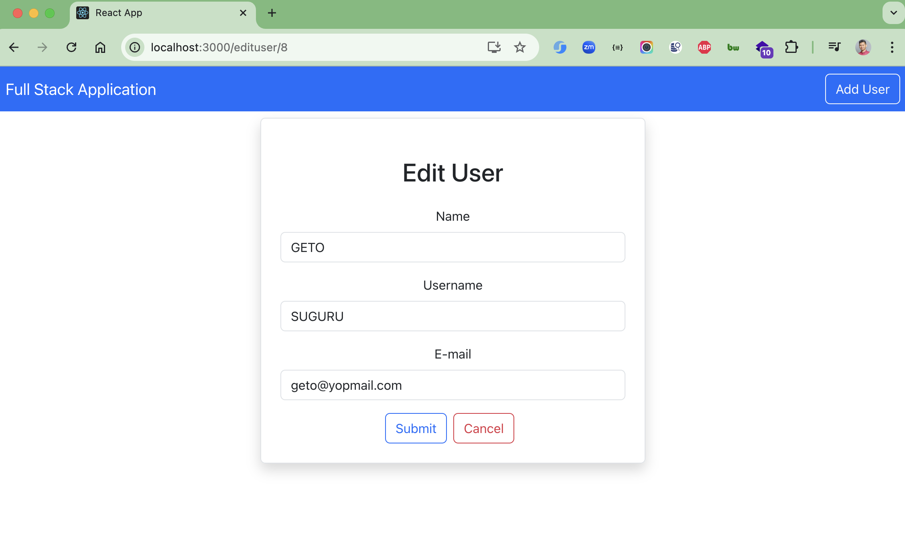

# spring-boot-react-users-crud

[](https://github.com/hendisantika/spring-boot-react-users-crud/actions/workflows/maven.yml)
[](https://github.com/hendisantika/spring-boot-react-users-crud/actions/workflows/reactjs.yml)


Simple full stack Users CRUD application built with **Spring Boot** (REST API) and **React** (frontend).

## Tech Stack

| Layer    | Technology                                                        |
|----------|-------------------------------------------------------------------|
| Backend  | Java 25, Spring Boot 4.1, Spring Data JPA, Lombok, Maven          |
| Database | MySQL 9 (via Docker Compose / Spring Boot Docker Compose support) |
| Testing  | JUnit 5, Testcontainers 2 (MySQL)                                 |
| Frontend | React 19, React Router 6, Axios, Bootstrap 5, pnpm 10             |
| CI/CD    | GitHub Actions, Dependabot                                        |

## Prerequisites

- JDK 25
- Maven 3.9+ (or use the bundled `./mvnw`)
- Docker & Docker Compose (MySQL database)
- Node.js 20+ and pnpm 10 (`corepack enable` will pick the version from `frontend/package.json`)

## Things to do list

1. Clone this repository: `git clone https://github.com/hendisantika/spring-boot-react-users-crud.git`
2. Go to the folder: `cd spring-boot-react-users-crud`
3. Run the application: `./mvnw clean spring-boot:run`
   (MySQL is started automatically from `compose.yaml` by Spring Boot Docker Compose support)
4. Go to frontend folder: `cd frontend`
5. Run the frontend: `pnpm install && pnpm start`
6. Open your favorite browser: http://localhost:3000

## REST API

Base URL: `http://localhost:8080/api/users`

| Method   | Endpoint          | Description       |
|----------|-------------------|-------------------|
| `GET`    | `/api/users`      | List all users    |
| `GET`    | `/api/users/{id}` | Get user by id    |
| `POST`   | `/api/users`      | Create a new user |
| `PUT`    | `/api/users/{id}` | Update a user     |
| `DELETE` | `/api/users/{id}` | Delete a user     |

## Build & Test

Backend:

```shell
./mvnw clean package
```

Frontend:

```shell
cd frontend
pnpm install
pnpm run lint
pnpm test --watchAll=false
pnpm run build
```

## Continuous Integration

- **Java CI with Maven** (`.github/workflows/maven.yml`): builds and tests the backend on JDK 25 (Temurin).
- **Node.js CI** (`.github/workflows/reactjs.yml`): lints, tests and builds the frontend on Node.js 20, 22 and 24.
- **Dependabot** (`.github/dependabot.yml`): keeps Maven, npm (`/frontend`), GitHub Actions and Docker Compose
  dependencies up to date with grouped pull requests.

## Image Screen shot

Add New User



List All Users



Details User



Update User


